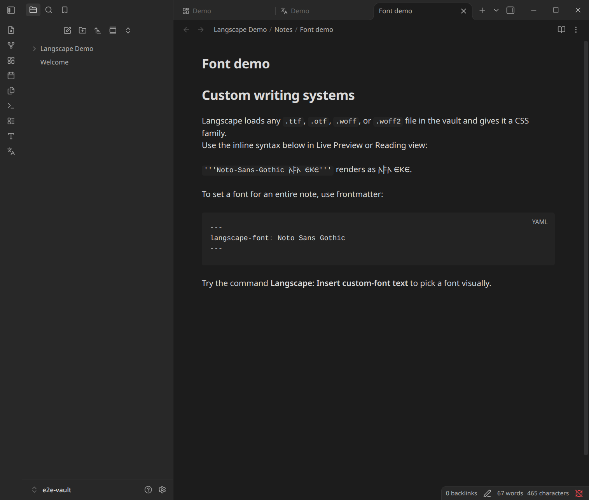
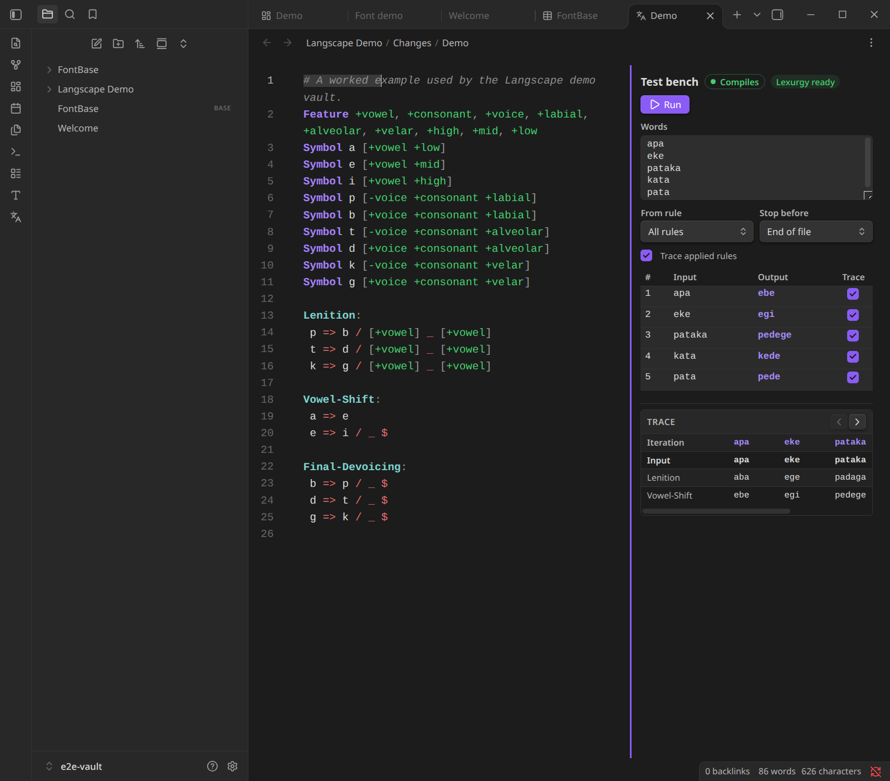
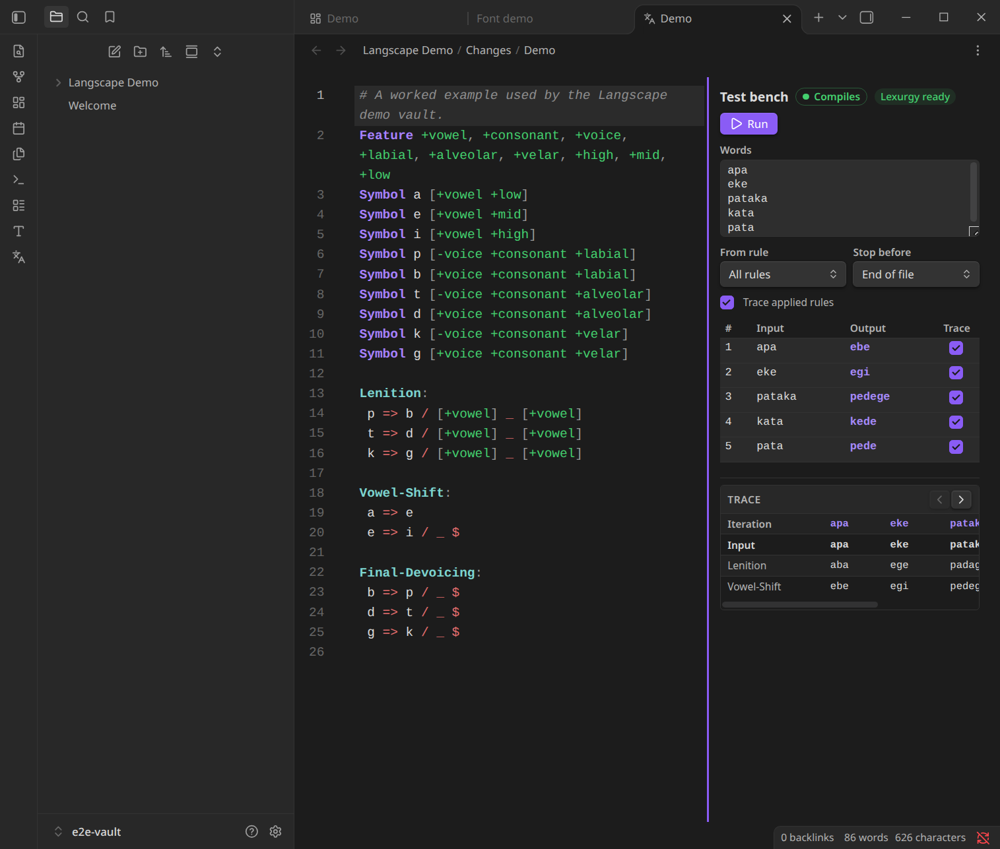
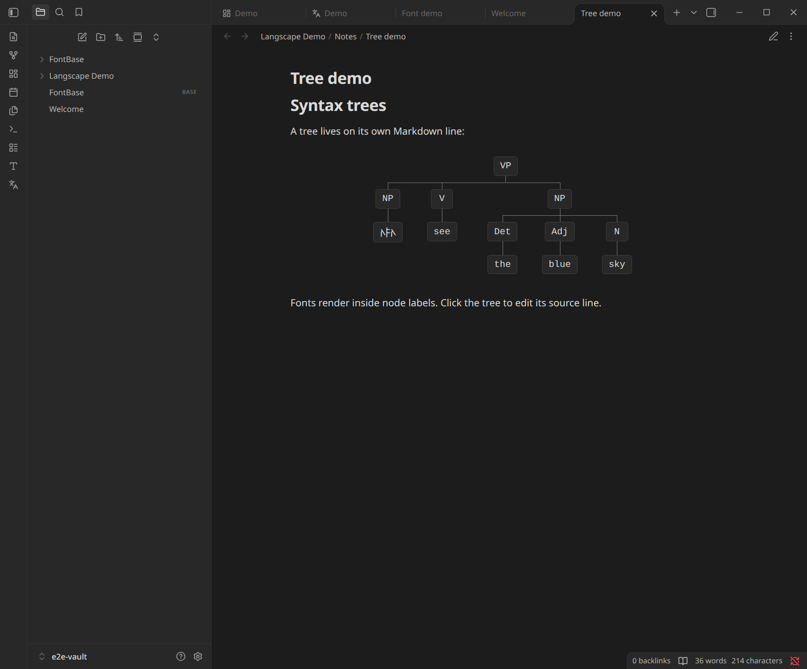
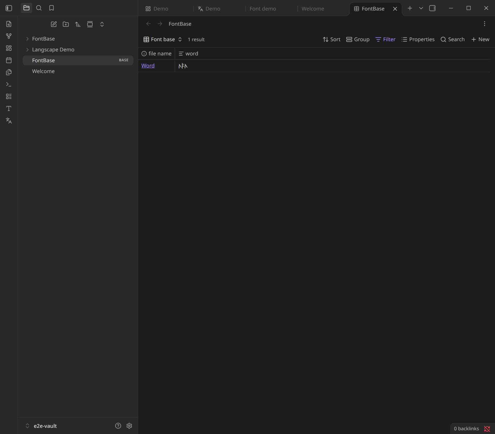
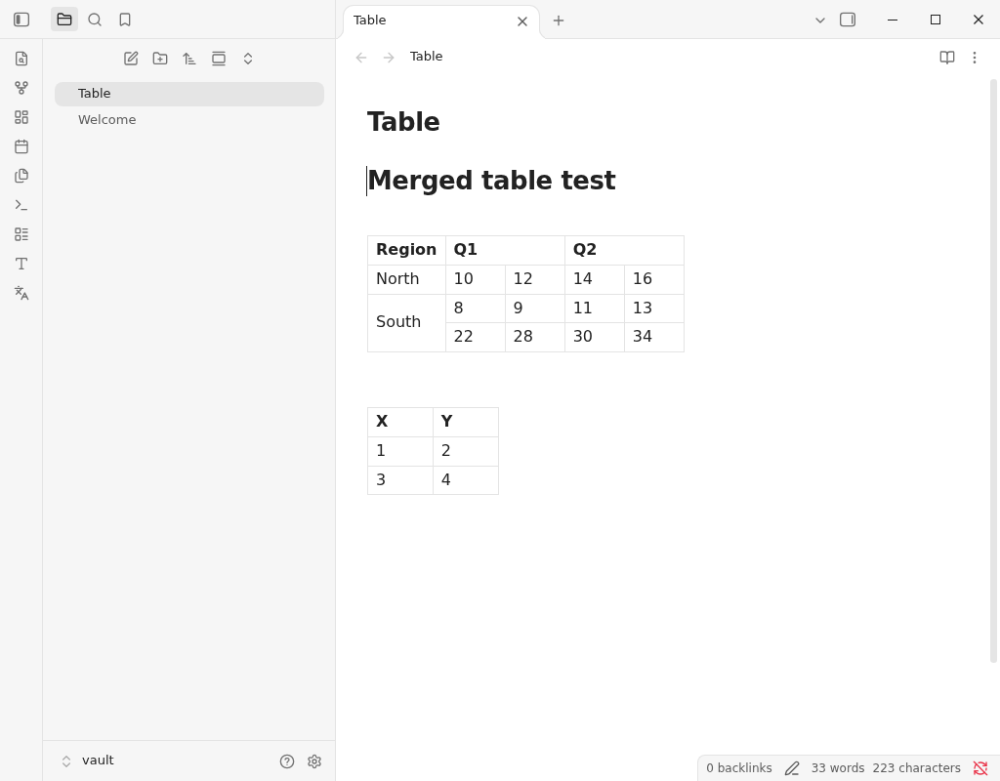
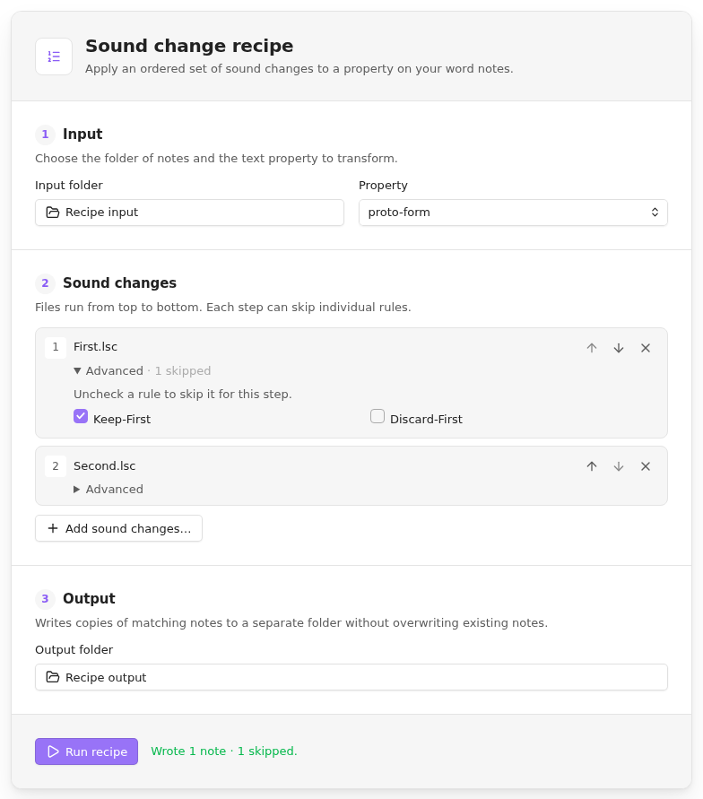

# Langscape

Langscape is a conlanger's workbench for [Obsidian](https://obsidian.md). It brings custom writing-system fonts, a Lexurgy sound-change editor, and sound-change recipes into the same vault as your notes.

> **Status:** 1.0.0 — desktop only. Minimum Obsidian 1.15.0; tested with Lexurgy 1.7.7.
>
> See the [changelog](CHANGELOG.md) for the release history.

[**Watch the Langscape 1.0 trailer**](<docs/video/langscape-trailer.mp4>) · [Credits](<trailer/README.md#music-credit>)

## Screenshots

| Fonts in Live Preview | Sound-change workbench |
| --- | --- |
|  |  |






## Features

- **Custom fonts everywhere** — drop `.ttf`, `.otf`, `.woff`, or `.woff2` files anywhere in the vault. Use `{nickname: text}` inline, or set a font for an entire note with `langscape-font` frontmatter. Fonts render in Live Preview, Reading view, and exported HTML/PDF.
- **Syntax trees** — write a tree on its own Markdown line with `{tree: ...}`. Node labels can use custom fonts, and trees render in Live Preview, Reading view, and exported HTML.
- **Merged table cells** — select cells and right-click to merge or split them, or type `<`, `^`, or `>` in an empty cell to join it to the cell in that direction. Merges render in Live Preview, Reading view, and exports while the note stays plain Markdown.
- **Sound-change workbench** — `.lsc` files open in a dedicated editor with Lexurgy syntax highlighting, live validation, and a test bench with rule-by-rule traces.
- **Lexurgy integration** — Langscape runs the official Lexurgy CLI as a persistent local server, so applying changes is fast. Use a separately installed Lexurgy CLI.
- **Sound-change recipes** — choose an input folder and note property, apply one or more Lexurgy files, and save the changed notes as copies in a separate folder.
- **Safe output** — recipes leave source notes untouched and refresh matching copies in the output folder.

## Installation

### From a release

Download the three plugin files from [GitHub Releases](https://github.com/KeylimeVI/Langscape/releases). You can also build a local ZIP with `npm run build` followed by `npm run package:release`; unpack it to get those same files.

1. Copy `main.js`, `manifest.json`, and `styles.css` into:
   ```
   <your vault>/.obsidian/plugins/langscape/
   ```
2. Enable **Community plugins → Langscape** in Obsidian.
3. To run sound changes, [set up Lexurgy and Java separately](#lexurgy). Fonts, trees, and tables do not need them.

### Build and install into a vault

`npm run install:vault` builds the plugin, finds the newest `dist/langscape-*.zip`, and replaces the installed Langscape build in your vault:

```bash
npm run install:vault
```

It defaults to `~/Documents/Obsidian Vault`; use `--vault` for another vault:

```bash
npm run install:vault -- --vault "/path/to/vault"
```

The script:

- runs `npm run build` and `npm run package:release`
- installs to `<vault>/.obsidian/plugins/langscape`
- preserves `data.json` and any legacy `lexurgy/` installation
- removes old versioned folders such as `langscape-0.1.0/` and old zips in the plugins folder
- ensures `langscape` is enabled in `community-plugins.json`

Useful flags:

```bash
npm run install:vault -- --dry-run      # show the plan without changing anything
npm run install:vault -- --no-build     # install the newest existing dist zip
npm run install:vault -- --no-preserve  # don't carry over data.json/lexurgy
```

Reload Obsidian, or disable/enable the plugin, after installing.

### Install a homelab build on another machine

Use `scripts/install-from-homelab.sh` on a second Fedora/KDE machine to replace the installed plugin in its vault. It defaults to `~/Documents/Obsidian Vault`, removes older `langscape*` plugin folders and build zips, and preserves `data.json` and the managed `lexurgy/` folder.

On Linux, open **Install Langscape.desktop** from the `scripts` folder to run the installer in a terminal. Keep it beside `install-from-homelab.sh`. If your file manager asks, mark the launcher as trusted or allow it to run. The launcher uses the default vault path; use the command-line version for a custom vault.

Requirements: `curl` and `unzip` (`sudo dnf install curl unzip`); `ssh`/`scp` only for direct homelab mode.

```bash
# Latest beta build
curl -fsSL https://raw.githubusercontent.com/KeylimeVI/Langscape/beta/scripts/install-from-homelab.sh | bash

# Install the build from main instead
LANGSCAPE_REF=main ./scripts/install-from-homelab.sh

# Plan only
./scripts/install-from-homelab.sh --dry-run

# Direct from the homelab over Tailscale
./scripts/install-from-homelab.sh --source ssh --host keylime@homelab
./scripts/install-from-homelab.sh --source ssh --host keylime@homelab --remote-build

# Other sources
./scripts/install-from-homelab.sh --source url --url https://example.com/langscape.zip
./scripts/install-from-homelab.sh --source file --zip dist/langscape-1.0.0.zip
```

Options: `--vault <path>`, `--no-preserve`, `--dry-run`, `--host <user@host>`, `--remote-repo <path>`, and `--remote-build`. By default the installer resolves GitHub’s `beta` branch to a commit and downloads its `dist/langscape-*.zip`. Use `--source ssh` to read the homelab checkout directly, optionally with `--remote-build` to rebuild it first. `HOMELAB_HOST` supplies the SSH host without switching the source; use `LANGSCAPE_SOURCE` to change the default source.

### Development and releases

Push ongoing work to `beta`, including the rebuilt `main.js` and `dist/langscape-*.zip` when the plugin changes. Promote batches of tested changes to `main` roughly every one to two weeks. Public GitHub releases are published separately from a version tag, not from ordinary pushes to either branch. Reload Obsidian, or disable/enable Langscape, after installing.

### From source

```bash
npm install
npm run build
```

The build writes `main.js`; copy it along with `manifest.json` and `styles.css` into your vault's plugin folder. To develop against a live vault:

```bash
npm run dev
```

## Fonts

### Inline

```markdown
The inscription reads {tengwar: elen síla}.
```

The text before the colon is the font nickname; the text after it is styled. Nicknames are set with the pencil button next to each font in **Settings → Langscape → Fonts**. They are case-insensitive.

If a font has no nickname, use its display name with spaces replaced by hyphens, for example `{Noto-Sans-Gothic: text}`.

The earlier `'''nickname text'''` and legacy `{font:Name|text}` forms are still supported for existing notes.

To show the markup literally, escape the opening delimiter:

```markdown
\{tengwar: elen síla}
```

### Whole note

```markdown
---
langscape-font: tengwar
---

All text in this note uses the font. Inline spans can still override it.
```

### Notes and limitations

- Font files are discovered automatically **anywhere in the vault**. Use **Rescan** in settings after adding one.
- Set a short nickname per font to keep inline markup compact.
- Font spans are processed per Markdown block. A span cannot cross a paragraph break; use the frontmatter font for whole-note styling.
- Lines containing Langscape font markup have native spellcheck disabled so conlang words and custom scripts are not shown with red squiggles. Other lines and other Markdown notes keep normal spellcheck. A note using whole-note `langscape-font` disables spellcheck throughout because all of its text uses the custom font.
- In Live Preview table cells, font spans stay rendered while the cell is being edited. Use Source mode if you need to edit the `{nickname: ...}` markup itself.
- Copying rendered font text puts its `{nickname: text}` markup on the clipboard, so pasting it back into a note keeps the font. Other applications will see the markup rather than just the plain text.
- Fonts are injected with `@font-face` from the vault's local resource URL. This works for desktop Obsidian and exported HTML. Mobile Obsidian is not supported in this version.

Use **Langscape: Insert custom-font text** in the command palette to pick a font visually. It inserts the `{nickname: text}` syntax for you.

### Bases

Table and card values using `{nickname: text}` are decorated live. Clicking into a Bases metadata cell temporarily restores the original markup so the value is not saved back without its font span.



## Tables



Ordinary Markdown tables can merge cells without turning into HTML. A cell whose only content is `<`, `^`, or `>` joins the cell in that direction:

```markdown
| Region | Q1 | < | Q2 | < |
| --- | --- | --- | --- | --- |
| North | 10 | 12 | 14 | 16 |
| ^ | 8 | 9 | 11 | 13 |
| South | 22 | 28 | 30 | 34 |
```

Here `Q1` spans two columns, `Q2` spans two columns, and `North` spans two rows (the `^` under North joins it to the row above; `South` starts the next row). The markers stay in the source, so the file is still an ordinary Markdown table.

- **Drag across cells** (or Shift-click) and **right-click** to get **Merge cells** and **Split cells**. If a selection touches an existing merged cell, it snaps to the full enclosing rectangle, so selections are always rectangular.
- In Live Preview, type **`<`**, **`^`**, or **`>`** in an empty cell to merge it in that direction immediately. The caret moves into the merged cell so you can keep typing.
- In Source mode, put the cursor in a table and use the right-click menu or the command palette: **Merge table cells**, **Split merged table cell**, and **Insert table**.
- Merging a selection joins all non-empty contents with a single space. Splitting keeps that text in the top-left cell and clears the others.
- A merge must be rectangular and cannot cross the header row. A group must contain exactly one content cell; cells filled by `<`, `^`, or `>` are markers.

To show a literal marker in a cell, escape it: `\<`, `\^`, or `\>`. A cell that contains anything besides marker characters is never treated as a merge. Other Markdown editors still see a valid table; they simply show the marker cells as literal text.

## Syntax trees

A tree is a complete line of Markdown:

```markdown
{tree: VP(NP(I), V(see), NP(Det(the), Adj(blue), N(sky)))}
```

Parentheses add children; commas separate siblings. A node without parentheses is a leaf. Spaces around labels and children are ignored:

```markdown
{tree: VP( NP(Det(the), N(sky)), V(see) )}
```

Font spans work inside node labels. The tree parser understands the nested braces:

```markdown
{tree: VP(NP({tengwar: 𐌰𐍆𐌰}), V(see), NP(Det(the), Adj(blue), N(sky)))}
```

In Live Preview, the source line is replaced by the tree and stays rendered while you edit it graphically:

- Hover a node and click **+** below it to add a child.
- Click a node's text to rename it. New nodes start empty and show a hollow-circle placeholder until named.
- Hover a node and click the **trash** control beside its text to delete it and its whole subtree. Deleting a subtree with two or more nodes asks for confirmation.
- Drag a label to move its entire subtree. Drop **on a label** to add it as that node's last child, or on the **left or right mark** beside a label to insert before or after it. The exact destination highlights while the tree stays in place. Drop in blank space or press Escape to cancel.
- Use the alignment toggle at the top-left of the tree to switch the whole tree between centered and left-aligned.
- Wide trees keep their full layout and get a horizontal scrollbar at the bottom instead of shrinking the nodes.

Right-click in a Markdown note, choose **Insert → Syntax tree**, or run **Langscape: Insert syntax tree** from the command palette, to add a single-node starter tree. In Reading view the tree is display-only; switch to Source mode if you want to edit the raw `{tree: ...}` syntax. Tree markup must be on a line by itself; inline uses are left as literal text.

### Notes and limitations

- Only one tree per line, and no surrounding prose on the same line.
- Labels may contain spaces and font spans. Commas and parentheses outside a font span are structural, so use a font span or a different label if you need those characters literally.
- Trees are rendered as HTML/CSS, not inserted into the Markdown file; the source stays portable.

## Sound-change editor

Click any `.lsc` file in the vault. Langscape opens a custom view:

- **Left:** a CodeMirror editor with Lexurgy syntax highlighting and a live error underline.
- **Right:** the test bench.

The test bench remembers the last words used for each file. Press **Run** (or `Mod+Enter`) to apply the changes. Drag the divider between the editor and the test bench to resize the sidebar; double-click it to reset, or use the arrow keys while it is focused. **Trace applied rules** asks Lexurgy for a rule-by-rule trace. When it is on, each result row gets a checkbox; select one or more words and their forms appear as columns across the top of the trace table, with the applied rules as rows. The trace table scrolls sideways when more words are selected than fit: use the horizontal scrollbar, the ‹ / › buttons in the trace header, Shift+wheel, or focus the table and use the arrow keys. Turning tracing off hides the trace UI entirely.

The **From rule** / **Stop before** selectors map to Lexurgy's `startAt` and `stopBefore` options, which is useful for inspecting intermediate stages.

Right-click empty space in the file explorer (or a folder) and choose **New Lexurgy file**. You can also run **Langscape: Create sound-change file** from the command palette. Both actions open a new `.lsc` file with the starter template.

Click **Docs** in the test bench to open the [official Lexurgy manual](https://www.lexurgy.com/sc/docs) in a separate Obsidian tab. The tutorial, cheat sheet, how-to, and reference use Obsidian’s theme and link to one another inside the tab. Pages load from the web, and example rules and input words are shown as selectable code. Use **View online** to run the official site’s interactive examples.

## Sound-change recipes



Right-click a folder or blank space in the file explorer and choose **New recipe**. The `.recipe` opens as a card with three sections:

1. **Input:** choose a folder and either a text property, such as `word`, or **Note title (filename)**. Property mode processes notes with a nonblank text value for that property. Title mode uses each note’s filename without `.md`, even if it has no frontmatter. Both modes ignore subfolders and non-Markdown files.
2. **Sound changes:** add one or more `.lsc` files. They run from top to bottom. Open **Advanced** on a file to disable individual rules for this recipe without editing the `.lsc` file.
3. **Output:** choose a different folder and press **Run recipe**. Property mode changes only the selected YAML value. Title mode changes only the copy’s filename. An invalid filename or two notes evolving to the same filename aborts the run before writing any copies.

Each run replaces same-name Markdown notes in the output folder, including any edits made to those copies. Notes with other filenames are left alone. The folder picker excludes nested vaults and linked folders. If an enabled rule calls a disabled deferred rule, Lexurgy reports the missing dependency before any copies are written. Existing `.canvas` files are not modified, but Langscape no longer runs sound changes from them.

### Starter vault

Run **Langscape: Create starter vault**, or use the button in settings. It creates:

```
Langscape Demo/
  Recipes/Demo.recipe
  Changes/Demo.lsc
  Words/Proto/{apa,eke,pataka}.md
  Words/Modern/
  Notes/Font demo.md
  Notes/Tree demo.md
  Fonts/NotoSansGothic-Regular.ttf
  Fonts/OFL-NotoSansGothic.txt
  README.md
```

Open the demo recipe and press **Run recipe** to copy the evolved notes to `Words/Modern`. The starter vault also includes an OFL font for the font demo.

## Lexurgy

Lexurgy is a separate GPL-3.0 program. Langscape does not bundle, install, or update it.

1. Install Java 17 or later, such as [Eclipse Temurin](https://adoptium.net/temurin/releases/).
2. Download the distribution ZIP from the [official Lexurgy releases](https://github.com/def-gthill/lexurgy/releases) and extract it into a folder of your choice.
3. In **Settings → Langscape → Lexurgy → Advanced**, set **Lexurgy path** to the extracted folder containing `lib/`, its launcher (`bin/lexurgy` or `bin/lexurgy.bat`), or a standalone Lexurgy `.jar`. You can also put the launcher on `PATH`. Set **Java path** if Java is not available through `JAVA_HOME` or `PATH`.
4. Use **Test** in Lexurgy settings to check your setup. If a beta build installed Lexurgy in the plugin folder, Langscape can still use that copy; there is no need to download it again.

### Privacy and system access

- **Local files and processes:** Langscape checks configured paths, Java and Lexurgy on `PATH`, and common local Lexurgy installation locations, which may be outside your vault. It reads the installed CLI files needed to start Lexurgy and runs Java/Lexurgy as a local child process. Rules and words are passed to that process over standard input, not sent to a server. Desktop path checks also inspect files inside the vault to avoid linked or nested-vault destinations.
- **Network:** The **Docs** tab fetches public pages from [lexurgy.com](https://www.lexurgy.com/sc/docs) and their published example source from `raw.githubusercontent.com`. It does not send note contents, rules, or words. Vault fonts load locally; old custom font entries with a web URL can still fetch that font from the configured host. Manual setup links open the official GitHub or Adoptium pages in your browser when clicked. No account, payment, or telemetry is required by Langscape; its editing and sound-change features work offline once Java and Lexurgy are installed.

## Development

Node.js 22 or newer is recommended for the development and browser-automation scripts.

```bash
npm install
npm run dev          # rebuild on change
npm run build        # typecheck + production bundle
npm test             # unit tests + real-Lexurgy integration tests when available
npm run typecheck
npm run test:obsidian  # focused real-Obsidian smoke test
```

The Lexurgy integration tests use `.tools/lexurgy.zip`. To fetch it:

```bash
mkdir -p .tools
curl -L -o .tools/lexurgy.zip \
  https://github.com/def-gthill/lexurgy/releases/download/v1.7.7/lexurgy-1.7.7.zip
```

Tests skip the JVM integration suite automatically when the archive or Java is missing.

For the full end-to-end check against real Obsidian, the repository includes `scripts/e2e-obsidian.mjs` (see the file header for prerequisites). It launches a disposable Obsidian instance against `.tools/e2e-vault`, creates the starter vault, exercises inline fonts, syntax trees and the `.lsc` test bench, checks syntax colours, and verifies the results through the Chrome DevTools Protocol.

```bash
npm run build
npm run test:e2e
```

The e2e script keeps its Obsidian profile in `.tools/e2e-home` between runs, accepts Obsidian's trust prompt automatically. Use `E2E_RESET=1` to start from a clean profile. It requires the extracted Obsidian build at `.tools/obsidian/obsidian-1.15.0/obsidian` and the real Lexurgy archive/Java for the integration portions.

For a fast table, font, clipboard, and Lexurgy UI check that needs no display server, run:

```bash
npm run test:obsidian
```

This launches Obsidian in headless mode with a disposable vault and profile under `.tools/headless-obsidian`, drives it through the DevTools Protocol, checks merged tables, active font cells, clipboard font markup, and rectangular selection, then writes a screenshot to `.tools/headless-obsidian/last-run.png`. It also checks that the explorer can create `.lsc` and `.recipe` files, that the test bench opens the Docs tab, and that a recipe copies notes with the selected property changed. Add `-- --live-docs` to verify the live manual, including navigation and examples. The smoke test requires the extracted Obsidian build at `.tools/obsidian/obsidian-1.15.0/obsidian` (or `OBSIDIAN_BIN`) and Node 22+. All of its writes stay inside the repository, so it runs without Xvfb or system permissions. Pass `--keep` to keep the temporary vault and profile after a successful run; failed runs are kept automatically for debugging.

## Project layout

```
src/
  main.ts                 plugin lifecycle and commands
  settings.ts             persisted settings
  settings-ui.ts          settings tab
  demo.ts                 starter-vault generator
  assets/                 starter-vault font and licence data
  fonts/                  discovery, OpenType name parsing, CSS, decorations, picker, clipboard
  tables/                 merged-cell parser, layout, Live Preview, Reading view, commands
  trees/                  syntax-tree parser, renderer, Live Preview editor
  lexurgy/                server protocol, process management, locator, installer
  soundchange/            .lsc view, syntax decorations, rule selectors, test bench
  recipes/                recipe card, file format, rule selection, note processing
  ui/                     prompt/confirm modals and anchored path picker
  utils/                  shared CodeMirror and vault helpers
tests/                    vitest unit + real-Lexurgy integration tests
scripts/                  e2e, headless smoke test, installers, packaging
.github/workflows/        CI and tagged-release automation
docs/                     screenshots, videos, and architecture notes
trailer/                  Remotion trailer source
```

## Limitations

- Desktop only. Lexurgy is a JVM program and the plugin uses Node child processes.
- Lexurgy is the sound-change engine. Langscape does not implement its own phonology engine.
- The font span syntax is intentionally simple and single-block; use note-level frontmatter for long passages.

## License

MIT. Lexurgy is separately licensed under GPL-3.0. The demo font Noto Sans Gothic is licensed under the SIL Open Font License 1.1; its licence is included in the starter vault.
