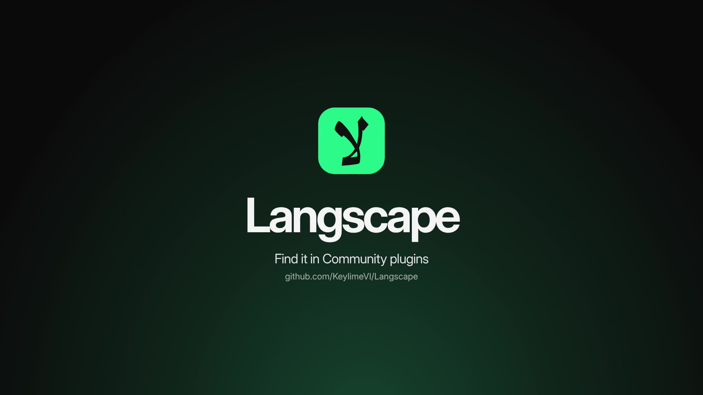
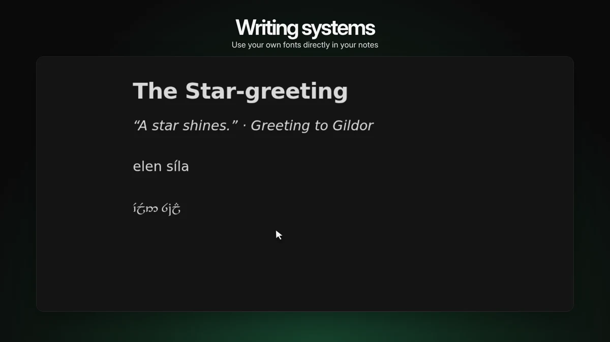
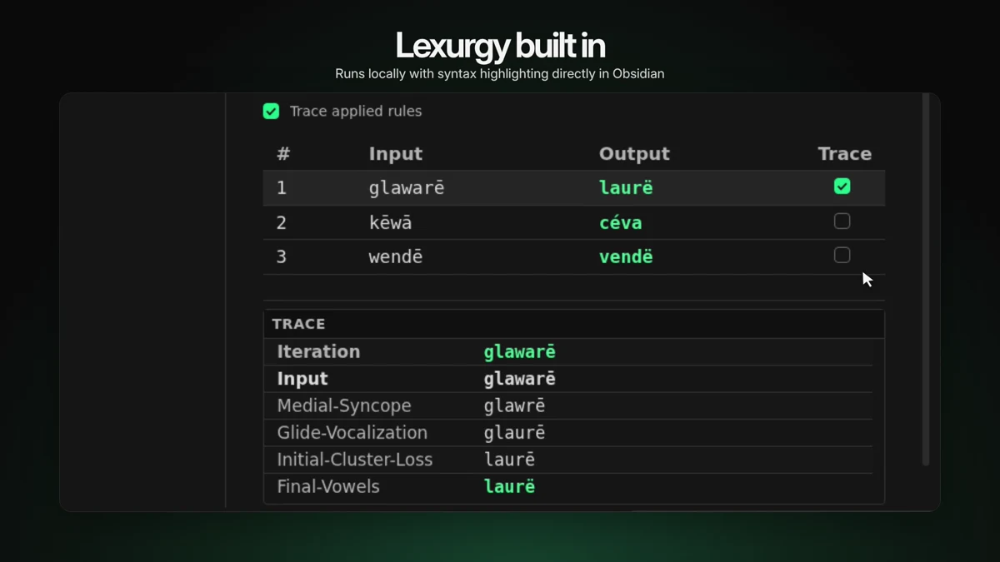
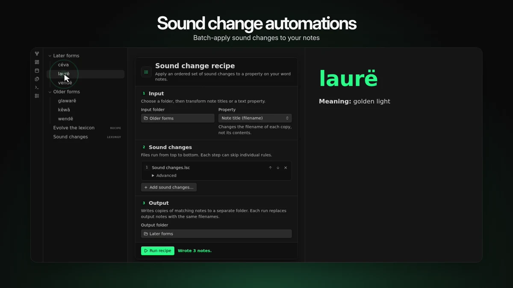
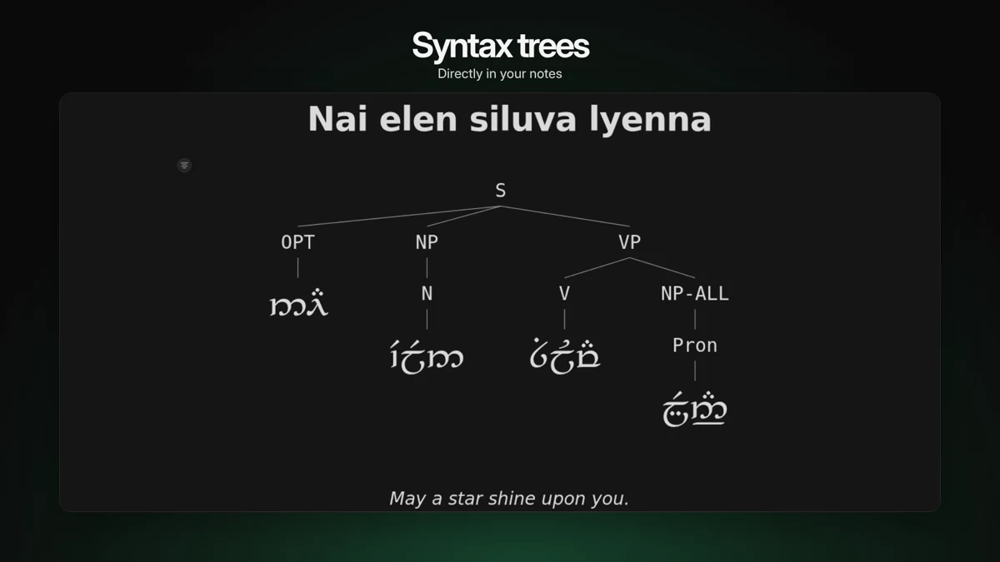

# Langscape

**A conlanger's toolkit for Obsidian.** Use your own writing systems, build syntax trees, and run sound changes without leaving your vault.

[Install in Obsidian](https://obsidian.md/plugins?id=langscape) · [GitHub releases](https://github.com/KeylimeVI/Langscape/releases) · [Changelog](CHANGELOG.md)

[Watch the trailer](docs/video/langscape-trailer.mp4) · [Visual credits](trailer/README.md#visual-credits)

## Features

| Writing systems | Lexurgy workbench |
| --- | --- |
|  |  |
| Drop a font into your vault and apply it to part of a note with `{nickname: text}` or to the whole note with the `langscape-font` property. | Edit `.lsc` files with syntax highlighting and live validation. Test words and see which rules changed them. Lexurgy runs locally. |

| Sound change automations | Syntax trees |
| --- | --- |
|  |  |
| Batch-apply sound changes to note titles or properties. Recipes leave the source notes alone and create or refresh copies in a separate folder. | Create and edit syntax trees directly in your notes with `{tree: S(NP, VP)}`. Labels can use custom fonts too. |

You can also **merge and split cells in Markdown tables** without converting the table to HTML.

## Get started

1. On desktop Obsidian **1.15.0 or later**, open **Settings → Community plugins**, search for **Langscape**, then install and enable it.
2. Run **Langscape: Create starter vault** from the command palette to try a demo. Java and Lexurgy aren't needed for fonts, trees, or tables.
3. To run sound changes, install [Java 17+](https://adoptium.net/temurin/releases/) and extract the [official Lexurgy distribution](https://github.com/def-gthill/lexurgy/releases). In **Settings → Langscape → Lexurgy → Advanced**, set the Lexurgy path if it isn't detected, then click **Test**. Langscape doesn't bundle or install Lexurgy.

For manual installation, download `main.js`, `manifest.json`, and `styles.css` from [GitHub Releases](https://github.com/KeylimeVI/Langscape/releases) and place them in `<vault>/.obsidian/plugins/langscape/` (or your vault's custom configuration folder).

## Contributions

Langscape is open source under the [MIT license](LICENSE), but I accept pull requests only rarely. GitHub gets a lot of low-effort AI-generated contributions, and I want to keep Langscape focused rather than let it grow bloated. Please [open an issue](https://github.com/KeylimeVI/Langscape/issues) before starting a patch. Small, tested fixes for an agreed problem are more likely to be accepted than unsolicited features or rewrites.

## Privacy

Langscape checks local paths for Java and Lexurgy, including locations outside your vault, and runs them as local processes. Rules and words are passed to Lexurgy locally, not uploaded. The in-app Docs tab fetches public manual pages from [lexurgy.com](https://www.lexurgy.com/sc/docs) and examples from `raw.githubusercontent.com`. Vault fonts load locally; older font entries configured with a URL still load from that host. Langscape has no telemetry.
