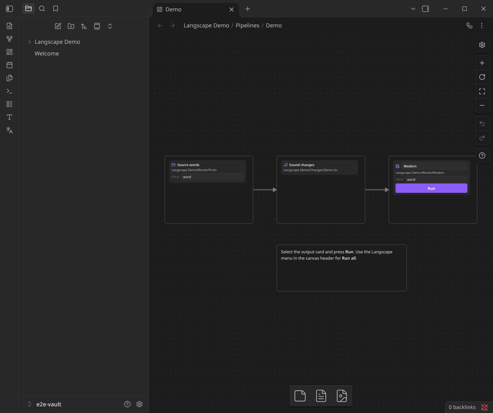
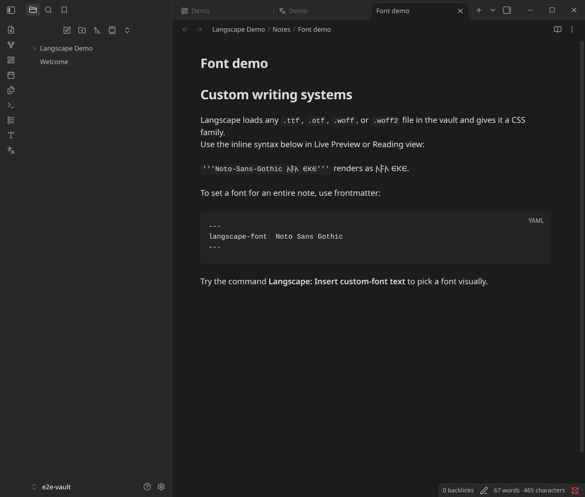
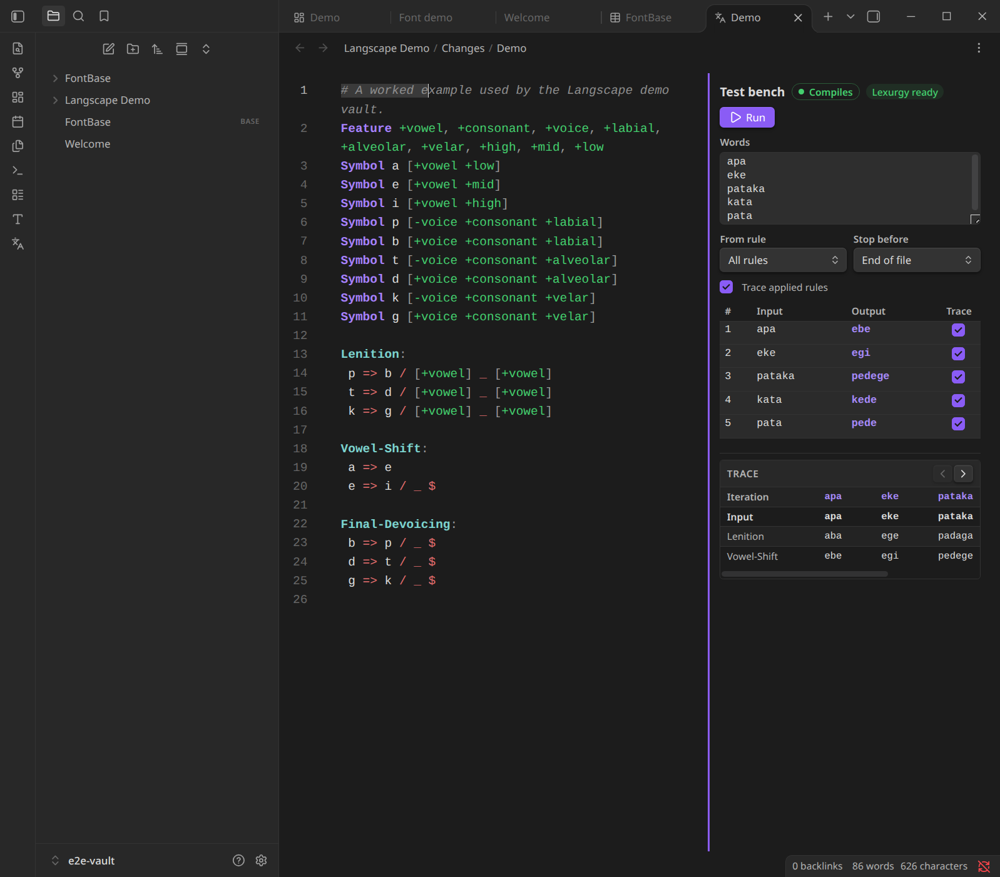
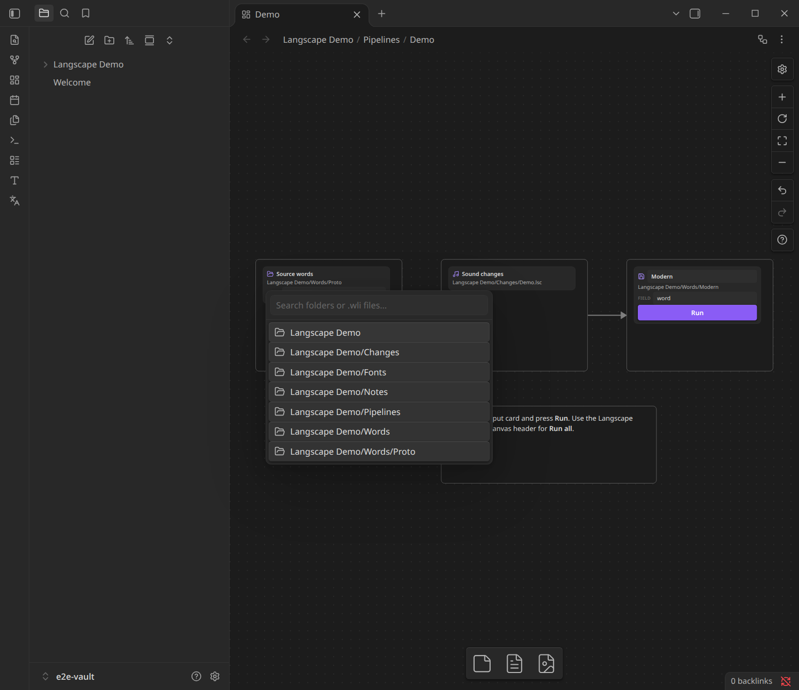
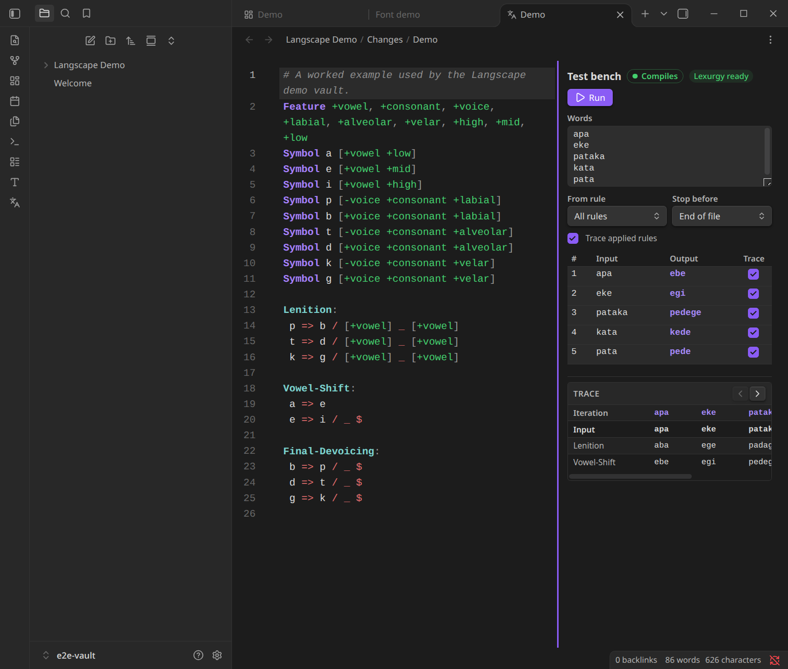
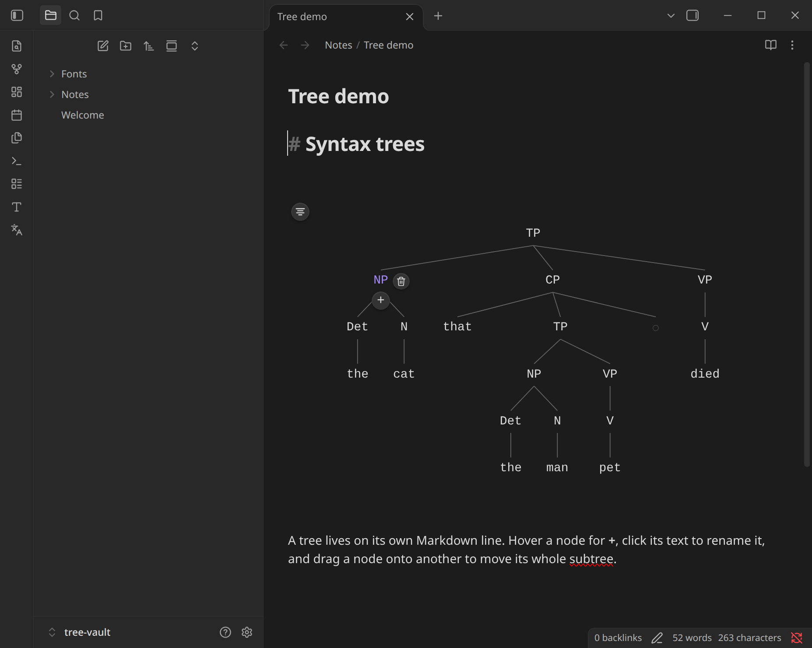
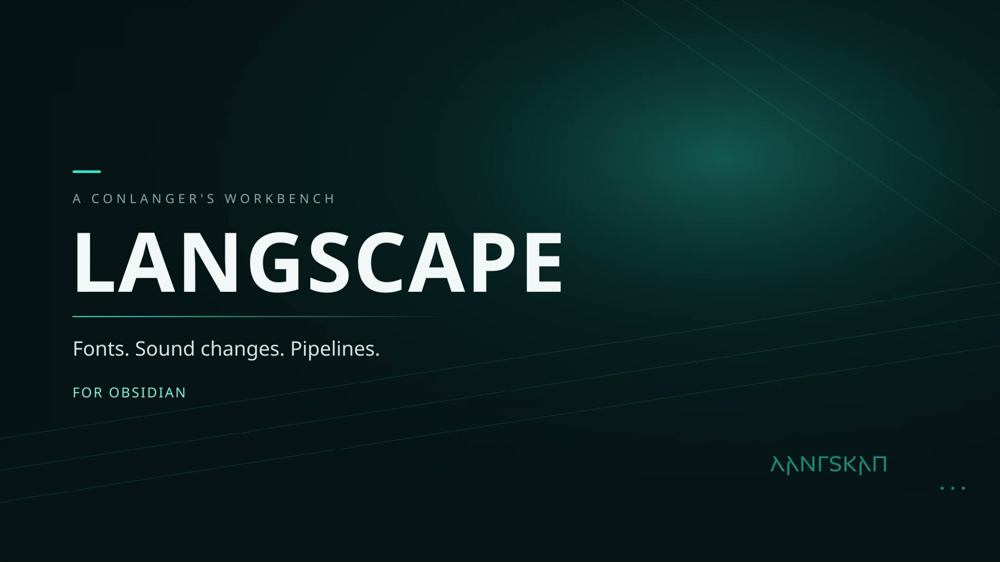
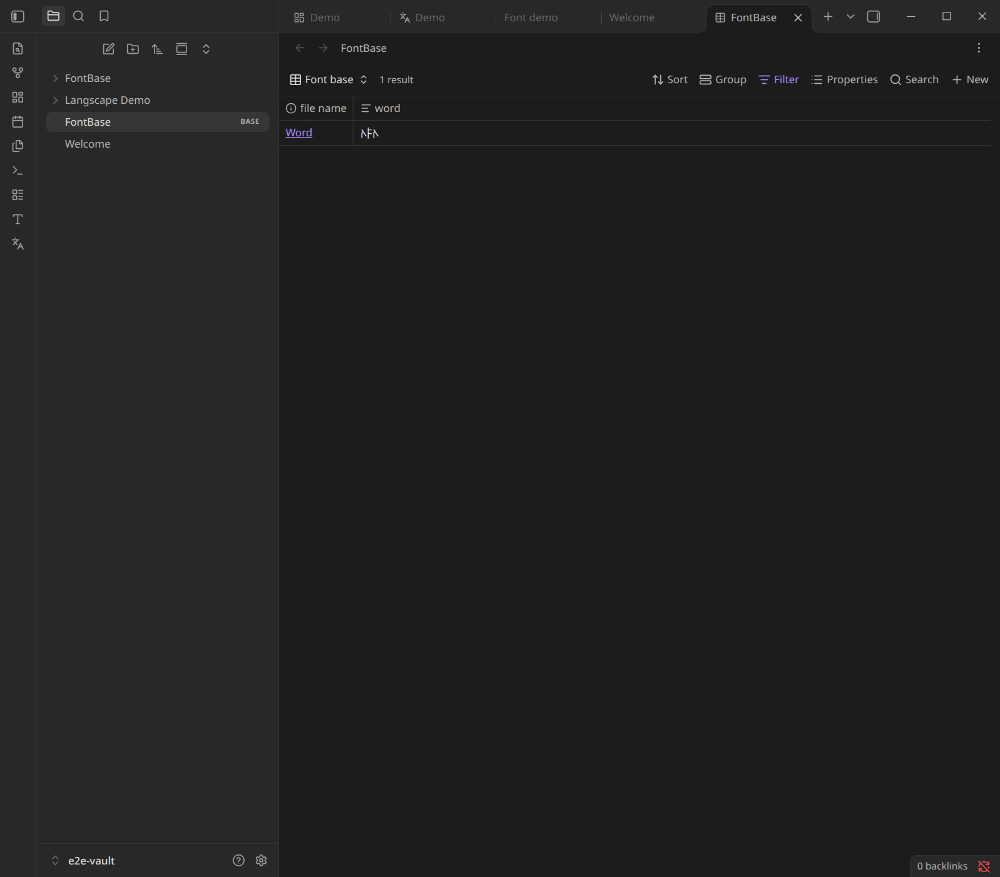

# Langscape

Langscape is a conlanger's workbench for [Obsidian](https://obsidian.md). It brings custom writing-system fonts, a Lexurgy sound-change editor, and canvas-driven word-evolution pipelines into the same vault as your notes.

> **Status:** 0.1.0 — desktop only. Built and tested against Obsidian 1.15.0 and Lexurgy 1.7.7.



## Screenshots

| Fonts in Live Preview | Sound-change workbench |
| --- | --- |
|  |  |








## Video overview

A short, no-voiceover tour of fonts, Lexurgy, pipelines, and Bases:

[Watch the Langscape overview](docs/video/langscape-overview.webm)

[](docs/video/langscape-overview.webm)

## Features

- **Custom fonts everywhere** — drop `.ttf`, `.otf`, `.woff`, or `.woff2` files anywhere in the vault. Use `{nickname: text}` inline, or set a font for an entire note with `langscape-font` frontmatter. Fonts render in Live Preview, Reading view, and exported HTML/PDF.
- **Syntax trees** — write a tree on its own Markdown line with `{tree: ...}`. Node labels can use custom fonts, and trees render in Live Preview, Reading view, and exported HTML.
- **Sound-change workbench** — `.lsc` files open in a dedicated editor with Lexurgy syntax highlighting, live validation, and a test bench with rule-by-rule traces.
- **Lexurgy integration** — Langscape runs the official Lexurgy CLI as a persistent local server, so applying changes is fast. Install or update the official CLI from settings, or point at an existing installation.
- **Canvas pipelines** — the canvas header has a Langscape menu for adding sources, sound changes, and outputs. Connect the cards with arrows, then press **Run** on an output card. **Run all** is in the same canvas menu.
- **Safe output** — generated notes are refreshed on every run, but human-written notes are never overwritten. Writing output into the source folder is rejected to prevent feedback loops.

## Installation

### From a release

A ready-to-install bundle is produced by `npm run package:release` at `dist/langscape-0.1.0.zip`. Unzip it into your plugin folder, or copy the three files manually.

1. Copy `main.js`, `manifest.json`, and `styles.css` into:
   ```
   <your vault>/.obsidian/plugins/langscape/
   ```
2. Enable **Community plugins → Langscape** in Obsidian.
3. Install Lexurgy:
   - Open **Settings → Langscape → Lexurgy** and click **Install Lexurgy**, or
   - Point **Lexurgy path** at an existing installation, or
   - Put `lexurgy` on your `PATH`.
4. Java 8 or newer is required for Lexurgy. Langscape checks for Java and shows the detected version.

### Build and install into a vault

`npm run install:vault` builds the plugin, finds the newest `dist/langscape-*.zip`, and replaces the installed Langscape build in your vault:

```bash
npm run install:vault
```

It defaults to `/home/keylime/Documents/Obsidian Vault`; use `--vault` for another vault:

```bash
npm run install:vault -- --vault "/path/to/vault"
```

The script:

- runs `npm run build` and `npm run package:release`
- installs to `<vault>/.obsidian/plugins/langscape`
- preserves `data.json` and the managed `lexurgy/` installation
- removes old versioned folders such as `langscape-0.1.0/` and old zips in the plugins folder
- ensures `langscape` is enabled in `community-plugins.json`

Useful flags:

```bash
npm run install:vault -- --dry-run      # show the plan without changing anything
npm run install:vault -- --no-build     # install the newest existing dist zip
npm run install:vault -- --no-preserve  # don't carry over data.json/lexurgy
```

Reload Obsidian, or disable/enable the plugin, after installing.

### From source

```bash
npm install
npm run build
```

The build writes `main.js`; copy it along with `manifest.json` and `styles.css` into your vault's plugin folder. To develop against a live vault:

```bash
npm run dev
```

## Fonts

### Inline

```markdown
The inscription reads {tengwar: elen síla}.
```

The text before the colon is the font nickname; the text after it is styled. Nicknames are set with the pencil button next to each font in **Settings → Langscape → Fonts**. They are case-insensitive.

If a font has no nickname, use its display name with spaces replaced by hyphens, for example `{Noto-Sans-Gothic: text}`.

The earlier `'''nickname text'''` and legacy `{font:Name|text}` forms are still supported for existing notes.

To show the markup literally, escape the opening delimiter:

```markdown
\{tengwar: elen síla}
```

### Whole note

```markdown
---
langscape-font: tengwar
---

All text in this note uses the font. Inline spans can still override it.
```

### Notes and limitations

- Font files are discovered automatically **anywhere in the vault**. Use **Rescan** in settings after adding one.
- Set a short nickname per font to keep inline markup compact.
- Font spans are processed per Markdown block. A span cannot cross a paragraph break; use the frontmatter font for whole-note styling.
- Lines containing Langscape font markup have native spellcheck disabled so conlang words and custom scripts are not shown with red squiggles. Other lines and other Markdown notes keep normal spellcheck. A note using whole-note `langscape-font` disables spellcheck throughout because all of its text uses the custom font.
- Fonts are injected with `@font-face` from the vault's local resource URL. This works for desktop Obsidian and exported HTML. Mobile Obsidian is not supported in this version.

Use **Langscape: Insert custom-font text** or the ribbon type icon to pick a font visually. It inserts the `{nickname: text}` syntax for you.

### Bases

Table and card values using `{nickname: text}` are decorated live. Clicking into a Bases metadata cell temporarily restores the original markup so the value is not saved back without its font span.



## Syntax trees

A tree is a complete line of Markdown:

```markdown
{tree: VP(NP(I), V(see), NP(Det(the), Adj(blue), N(sky)))}
```

Parentheses add children; commas separate siblings. A node without parentheses is a leaf. Spaces around labels and children are ignored:

```markdown
{tree: VP( NP(Det(the), N(sky)), V(see) )}
```

Font spans work inside node labels. The tree parser understands the nested braces:

```markdown
{tree: VP(NP({tengwar: 𐌰𐍆𐌰}), V(see), NP(Det(the), Adj(blue), N(sky)))}
```

In Live Preview, the source line is replaced by the tree and stays rendered while you edit it graphically:

- Hover a node and click **+** below it to add a child.
- Click a node's text to rename it. New nodes start empty and show a hollow-circle placeholder until named.
- Hover a node and click the **trash** control beside its text to delete it and its whole subtree. Deleting a subtree with two or more nodes asks for confirmation.
- Drag a node onto another node to make it a child; drop on the left or right side of a node to place it before or after that sibling instead. While dragging, the subtree previews in the accent color at its destination, with an accent edge to its new parent.
- Use the alignment toggle at the top-left of the tree to switch the whole tree between centered and left-aligned.

Right-click in a Markdown note, choose **Insert → Syntax tree**, or run **Langscape: Insert syntax tree** from the command palette, to add a single-node starter tree. In Reading view the tree is display-only; switch to Source mode if you want to edit the raw `{tree: ...}` syntax. Tree markup must be on a line by itself; inline uses are left as literal text.

### Notes and limitations

- Only one tree per line, and no surrounding prose on the same line.
- Labels may contain spaces and font spans. Commas and parentheses outside a font span are structural, so use a font span or a different label if you need those characters literally.
- Trees are rendered as HTML/CSS, not inserted into the Markdown file; the source stays portable.

## Sound-change editor

Click any `.lsc` file in the vault. Langscape opens a custom view:

- **Left:** a CodeMirror editor with Lexurgy syntax highlighting and a live error underline.
- **Right:** the test bench.

The test bench remembers the last words used for each file. Press **Run** (or `Mod+Enter`) to apply the changes. Drag the divider between the editor and the test bench to resize the sidebar; double-click it to reset, or use the arrow keys while it is focused. **Trace applied rules** asks Lexurgy for a rule-by-rule trace. When it is on, each result row gets a checkbox; select one or more words and their forms appear as columns across the top of the trace table, with the applied rules as rows. The trace table scrolls sideways when more words are selected than fit: use the horizontal scrollbar, the ‹ / › buttons in the trace header, Shift+wheel, or focus the table and use the arrow keys. Turning tracing off hides the trace UI entirely.

The **From rule** / **Stop before** selectors map to Lexurgy's `startAt` and `stopBefore` options, which is useful for inspecting intermediate stages.

Create a new file with **Langscape: Create sound-change file**. The starter template includes remarks and a working feature set.

## Canvas pipelines

Langscape reads ordinary Obsidian Canvas files. Any text card containing a fenced `langscape` block is a pipeline step. Connect the cards with Canvas arrows; data flows along those arrows.

### Node types

Source folder — reads the `word` field from every Markdown note in a folder. `.wli` files are also supported.

````markdown
```langscape
type: source
path: Words/Proto
# optional:
field: word
format: markdown
```

Words from `Words/Proto` become the pipeline input.
````

Inline words — useful for quick experiments.

````markdown
```langscape
type: words
words:
  - apa
  - eke
  - pataka
```
````

Sound changes — apply a Lexurgy file. Multiple incoming paths are merged.

````markdown
```langscape
type: sound-change
file: Changes/Modern.lsc
# optional:
startAt: Lenition
stopBefore: Raising
```
````

Output — write one Markdown note per evolved word, or a single `.wli` word list.

````markdown
```langscape
type: output
path: Words/Modern
format: markdown
# optional:
field: word
name: Modern
filename: "{word}"
overwrite: true
```
````

````markdown
```langscape
type: output
path: Build/evolved.wli
format: wli
```
````

**Paths are vault-relative**, not relative to the canvas. An optional `label:` gives a step a friendlier name on the canvas card.

### Running

- Open the canvas and use the **Langscape** menu in the canvas header (workflow icon) to add sources, sound changes, and outputs. The pickers are searchable in-vault lists, not native OS dialogs; the output picker also accepts a typed new folder path.
- Source and output cards have a **field** textbox for the word property. Output cards also have an editable title for the pipeline/language name.
- Double-click a folder or file name on a card to change it. Double-click a sound-change card to open the `.lsc` file. Double-clicking other parts of a card does not open the block's YAML metadata.
- Press **Run** on an output card to run only that output's branch.
- Use **Run all** in the same header menu to run every output.
- The command palette also has **Langscape: Run all pipelines in the active canvas**.

A successful run writes to the output folder and shows a short notification summary. Generated notes contain:

```yaml
---
source: "[[Words/Proto/word]]"
original: "proto-form"
word: "evolved-form"
pipeline: "Modern"
---
```

Generated notes contain only those properties; there is no body or stage table. The `pipeline` value defaults to the output folder name (the “final language”) and can be overridden with `name:` on the output block. Re-running updates notes that Langscape generated; human notes are left alone and a numbered filename is used instead.

The property that holds the word can be changed per block:

```langscape
# Source block: which property to read
type: source
path: Words/Proto
field: word
```

```langscape
# Output block: which property to write, and the language name
type: output
path: Words/Modern
field: word
name: Modern
```

### Canvas pipeline rules

- Sources and inline-word steps cannot have incoming arrows.
- Sound-change and output steps need at least one incoming arrow.
- Cycles are rejected.
- An output folder inside a source folder is rejected (it would feed generated notes back into the next run).
- A step with no incoming data is an error; a valid pipeline needs at least one source and one output.

### Starter vault

Run **Langscape: Create starter vault**, or use the button in settings. It creates:

```
Langscape Demo/
  Pipelines/Demo.canvas
  Changes/Demo.lsc
  Words/Proto/{apa,eke,pataka}.md
  Notes/Font demo.md
  Fonts/NotoSansGothic-Regular.ttf
  README.md
```

The demo is a working three-step pipeline and includes an OFL font for the font demo.

## Lexurgy

Langscape uses the official [Lexurgy](https://github.com/def-gthill/lexurgy) CLI. It is a separate GPL-3.0 program; Langscape does not bundle or relicense it. The managed installer downloads the official release zip from GitHub into:

```
<vault>/.obsidian/plugins/langscape/lexurgy/
```

The download is only started when you click **Install Lexurgy**, and the licence and attribution are stored next to the installation. Langscape invokes Lexurgy as a child process over its JSON-lines `lexurgy server` protocol.

If you prefer to manage Lexurgy yourself, set **Lexurgy path** to one of:

- a directory containing `lib/*.jar` (a normal Lexurgy distribution),
- a `bin/lexurgy` script,
- a standalone Lexurgy `.jar`.

Java is found through **Java path**, `JAVA_HOME`, or `java` on `PATH`. If Java is missing, the Lexurgy settings show a **Get Java** link to the official Adoptium JRE download page, and the editor's setup banner offers the same link.

## Development

```bash
npm install
npm run dev          # rebuild on change
npm run build        # typecheck + production bundle
npm test             # unit tests + real-Lexurgy integration tests when available
npm run typecheck
```

The Lexurgy integration tests use `.tools/lexurgy.zip`. To fetch it:

```bash
mkdir -p .tools
curl -L -o .tools/lexurgy.zip \
  https://github.com/def-gthill/lexurgy/releases/download/v1.7.7/lexurgy-1.7.7.zip
```

Tests skip the JVM integration suite automatically when the archive or Java is missing.

For an end-to-end check against real Obsidian, the repository includes `scripts/e2e-obsidian.mjs` (see the file header for prerequisites). It launches a disposable Obsidian instance against `.tools/e2e-vault`, creates the starter vault, runs the demo pipeline and a single-output branch, tests the canvas add-step menu and card errors, exercises inline fonts and the `.lsc` test bench, checks syntax colours, and verifies the results through the Chrome DevTools Protocol.

```bash
npm run build
npm run test:e2e
```

The e2e script keeps its Obsidian profile in `.tools/e2e-home` between runs, accepts Obsidian's trust prompt automatically, and closes the run-result modal before moving on, so it does not leave a “Pipeline complete” dialog on screen. Use `E2E_RESET=1` to start from a clean profile.

## Project layout

```
src/
  main.ts                 plugin lifecycle, commands, canvas execution
  settings.ts             persisted settings
  settings-ui.ts          settings tab
  fonts/                  discovery, OpenType name parsing, CSS, decorations, picker
  lexurgy/                server protocol, process management, locator, installer
  soundchange/            .lsc view, syntax decorations, rule selectors, test bench
  pipeline/               canvas model, graph validation, words, card UI, runner, writer
  ui/                     small prompt/confirm modals
tests/                    vitest unit + real-Lexurgy integration tests
docs/                     screenshots and architecture notes
```

## Limitations

- Desktop only. Lexurgy is a JVM program and the plugin uses Node child processes.
- Lexurgy is the sound-change engine. Langscape does not implement its own phonology engine yet; the `pipeline` layer is deliberately independent of the Lexurgy client so another engine can be added later.
- Canvas has no public plugin API for adding or editing nodes from another plugin, but Langscape uses the Canvas view's runtime node API for its Add menu. Cards render their own controls and errors.
- The canvas menu is the main control surface; there is no separate pipeline sidebar.
- The font span syntax is intentionally simple and single-block; use note-level frontmatter for long passages.

## License

MIT. Lexurgy is separately licensed under GPL-3.0. The demo font Noto Sans Gothic is licensed under the SIL Open Font License 1.1; its licence is included in the starter vault.
